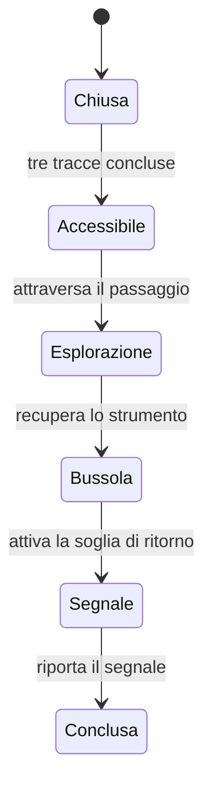

# Prossima area proposta — Il giardino dei nomi

Design Codex del 10 novembre 2026. Prima implementazione locale in verifica:
accesso dopo tre tracce, bussola, segnale/ritorno e sentinella rettilinea. Trama
non approvata come canone; prova umana non svolta. Verifiche correnti in HANDOFF.

## Obiettivo e chiusura

Dopo la firma Cartiglio, raggiungere il giardino, recuperare una bussola di
spedizione e portare un segnale fino alla soglia. L'obiettivo è diverso dalle
tre tracce: entrare, prendere qualcosa sotto pressione e trovare il ritorno.
Chiude il recupero di uno strumento e apre una domanda precisa: la bussola viene
ancora corretta da qualcuno dall'interno, oppure è soltanto un vecchio automatismo?
Non dichiarare già salvata la squadra.

La bussola è un oggetto di missione, non valuta o loot casuale. Il suo ago e una
breve annotazione di Liora devono dare l'indizio: evitare un'altra lunga finestra
espositiva. Alla fine la mappa conserva il passaggio e il giocatore può tornare
alla prima area. Nessuna ricompensa economica o obbligo giornaliero.

## Spazio e incontro

Prima porzione circoscritta: cortile/giardino con ingresso leggibile, due percorsi
che si ricongiungono al piedistallo e una via di ritorno. Non promettere chilometri
prima di aver verificato densità e orientamento.

- Via centrale più breve, esposta alla sentinella; colonne come copertura visibile.
- Via laterale più lunga, aggira parte del pericolo e lascia spazio a una nota ambientale ancora da implementare.
- Piedistallo riconoscibile per sagoma, ago luminoso e suono opzionale.

Nemico proposto: sentinella Cartiglio che cambia postazione e prepara un attacco
rettilineo, anziché inseguire come gli echi. Mostrare larghezza e linea d'impatto,
con preparazione proposta di 1,4 s, da verificare. Il giocatore può interrompere,
sfruttare copertura o aggirare: non è obbligatorio eliminarla per prendere l'oggetto.
Tutte le classi devono poter completare il percorso; niente requisito Ranger.

La nuova meccanica del Ranger può offrire un contrattacco rischioso, senza
trasformare l'area in un tutorial obbligatorio per quella classe. La copertura
va verificata nella simulazione: una colonna disegnata non blocca da sola un raggio.

## Stato e ripresa

Ogni passaggio deve essere idempotente. Separare stato dell'area da cleared del
primo Custode: nuovi nemici non devono riaprire il vecchio episodio o duplicarne
l'evoluzione. Nessuna perdita definitiva dell'oggetto alla disconnessione.

Il formato v2 descrive questi stati e legge v1 senza scritture automatiche; non reinterpretare
silenziosamente traces e non cancellare dati illeggibili. La ripresa deve ricreare
un punto sicuro e conservare l'oggetto una volta, senza mantenere un combattimento
parziale. I dati client restano non autorevoli per qualsiasi economia futura.

## Criteri per l'implementazione

Passaggio fra due aree con andata/ritorno, obiettivo comprensibile e nuova scoperta;
nessuna teletrasportazione oltre un accesso chiuso. Documentare se la seconda area
viene caricata davvero su richiesta o è già nella scena: non chiamare entrambe
le soluzioni streaming. Controllare risorse al cambio area e ripetendo il passaggio.

Verificare le sei classi, coperture, aggiramento, sconfitta/ripresa, checkpoint e
assenza di premi duplicati; poi regressione del primo episodio e prova umana.
Chiedere al giocatore cosa cercava e quale indizio ha usato, senza spiegarglielo
prima. Correggere almeno i problemi bloccanti prima di allargare la mappa.

Incarico Codex registrato in COLLABORATION. La geometria viene creata al primo
ingresso e conservata per il riuso: non è streaming di file o del mondo.
Nessun lavoro svolto o revisione di Claude presunti.

Le colonne bloccano il raggio, i proiettili del giocatore e gli attacchi fisici
diretti. Impulsi e implosioni ad area restano effetti magici e non dipendono
da una traiettoria di freccia. In orizzontale le azioni della missione sono nella
fascia superiore per separarle dal joystick. Movimento assistito opzionale in
linea verso gli obiettivi, interrompibile con i comandi; non è pathfinding.
