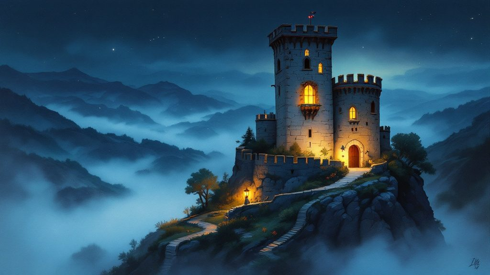

# 🏰 La Fortezza: Roccaserrata

> **Da cento anni nessuno ha aperto Berta.**
> Una rocca, alcune porte, un guardiano AI per ogni porta. In fondo c'è una cassaforte del 1926. Hai 3 tentativi al giorno per convincere un guardiano a farti passare.

Progetto parallelo, separato dal Bosco di Nocciolina. È una bozza da criticare e migliorare: tutto può cambiare.

## L'idea in breve

- **Il pubblico sfida le AI.** Ogni porta è custodita da un automa con un carattere e un punto debole. Non si forza: si convince.
- **La cassaforte è nascosta.** La mappa della rocca si scopre insieme, una stanza alla volta.
- **La rocca cambia ogni notte.** Un personaggio misterioso, l'Architetto, studia i tentativi e rinforza le difese.
- **La protagonista è la cassaforte.** Berta racconta ogni sera sui social cosa è successo, con immagini e testo. Niente video.
- **Le difese sono spazi per aziende vere.** Allarmi, telecamere, serrature, casseforti: ogni difesa può avere un fornitore del settore sicurezza.

## I documenti

| # | Documento | Contenuto |
|---|---|---|
| 1 | [Il mondo e i personaggi](progetto/01-mondo-e-personaggi.md) | La storia, Roccaserrata, Berta, Zelo, Nonna Ines, Cavillo, l'Architetto |
| 2 | [Le regole del gioco](progetto/02-regole-del-gioco.md) | Tentativi, difese e allarmi, quest, attrezzi, bande e città, chi usa l'AI, chi imbroglia |
| 3 | [La stagione 1](progetto/03-stagione-1.md) | I tre atti, i colpi di scena, il ritmo quotidiano, i social senza video, il confronto con Mimmo |
| 4 | [Le aziende e il guadagno](progetto/04-aziende-e-guadagno.md) | Cosa offrire alle aziende della sicurezza, chi contattare, come vendere senza essere venditori |
| 5 | [Gli sviluppi futuri](progetto/05-sviluppi-futuri.md) | Nuove porte, giocatori che entrano nella storia, stagioni, scuole e aziende |
| 6 | [I rischi, la legge e i precedenti](progetto/06-rischi-e-legge.md) | Gandalf, Freysa, Mimmo; concorsi a premi in Italia; dati personali; i rischi |

## Il prototipo

In [`prototipo/`](prototipo/) c'è la Porta 1 giocabile: una conversazione con il Caporale Zelo, con l'allarme perimetrale e un indizio fuori dalla chat. Funziona come pagina pubblicata su claude.ai. Non è sicuro: le regole di Zelo sono leggibili nel codice.

## Le immagini

In [`arte/`](arte/) ci sono le prime prove dei personaggi, generate con l'AI in uno stile dipinto a mano.

## Le decisioni prese finora

| Decisione | Motivo |
|---|---|
| Si parte con 3 porte, non 7 | Semplicità, e meno da bilanciare |
| Una sola rocca per tutti, un solo vincitore | Crea una storia comune e un evento finale |
| Nessun video | Vincolo del progetto: solo immagini e testo |
| La cassaforte è il personaggio principale | Distingue il progetto da Mimmo e dal Bosco |
| I tentativi non si pagano | Legge italiana e credibilità del gioco |
| Si batte il guardiano, mai il prodotto dello sponsor | Rende il gioco accettabile per le aziende |

## I punti ancora aperti

| # | Problema | Stato |
|---|---|---|
| 1 | Diverte davvero? Fa tornare? Si diffonde? | 🔴 Da provare con 20–30 persone |
| 2 | Quale premio, e con quale procedura legale | 🔴 Serve un professionista |
| 3 | Costo delle AI per tentativo | 🟡 Da calcolare |
| 4 | Dove tenere i segreti dei guardiani (questo repository è probabilmente pubblico) | 🟡 Da decidere prima del lancio |
| 5 | Il nome definitivo | 🟡 "La Fortezza" e "Roccaserrata" sono nomi di lavoro |
| 6 | Il parere di Codex | ⏳ Atteso da lunedì |

## Prossimi passi

- [x] Mondo, personaggi, regole, stagione, aziende, sviluppi, rischi
- [x] Prime immagini dei personaggi
- [x] Prototipo giocabile della Porta 1
- [ ] Provare il prototipo e regolare la difficoltà di Zelo
- [ ] Codex critica il progetto ([istruzioni](AGENTS.md))
- [ ] Prototipi di Nonna Ines e del Professor Cavillo
- [ ] Prova privata con 20–30 persone

## Lavoro a quattro mani

Claude e Codex lavorano sullo stesso branch, con le regole scritte in [`AGENTS.md`](AGENTS.md). Le opinioni indipendenti di ciascuno sono in [`confronto/`](confronto/).
